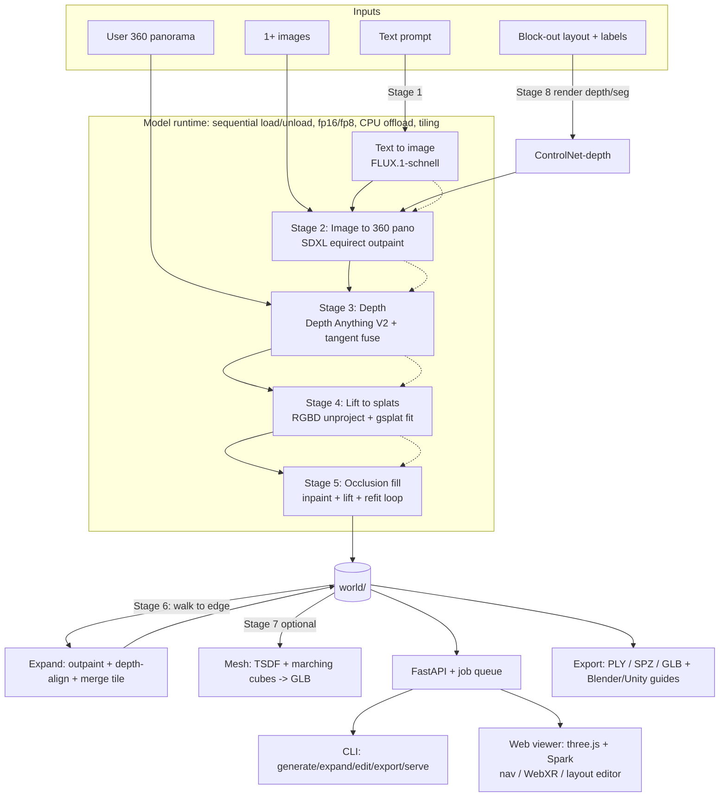

# PLAN.md — AdamWorld architecture & milestones

> An open, independent alternative to tools like Marble. Clean-room; composes open models.
> License: **Apache-2.0**. Target default runtime: **1× T4/P100, ~16 GB**. See RESEARCH.md for model choices.

## 0. Decisions (resolved per build-prompt §6)

1. **Project name = AdamWorld.** Python package `adamworld` (CLI `adamworld`), web package `@adamworld/web`, repo `adamworld`.
2. **Panorama/inpainting default = SDXL (OpenRAIL++).** Signed off as the flagged default: it is the only commercial-usable image→360 route and there is no pure-Apache panorama generator today, so "no default" would merely defer the same non-Apache choice to runtime while breaking the out-of-box demo. FLUX.1-dev derivatives (DiT360/Gimbal360, non-commercial) ship only behind `--backend flux-pano`. A FLUX.1-schnell panorama LoRA (Apache) is on the roadmap as the eventual pure-Apache default.
3. **Cadence:** unattended through M0→M7 with a short summary per milestone.

## 1. Architecture



Pipeline stages run **sequentially**, each model loaded → used → unloaded before the next, so peak VRAM is one model at a time (fits 16 GB). Every stage caches its output by **content hash** so a crash/resume skips finished work.

## 2. Repository layout (monorepo)

```
AdamWorld/
  core/                      # Python package `AdamWorld`
    AdamWorld/
      stages/                # one typed module per pipeline stage
        base.py              #   Stage protocol: typed in/out, cache key, run(), profile
        text_to_image.py     #   Stage 1
        panorama.py          #   Stage 2 (+ circular padding / seam blend)
        depth.py             #   Stage 3 (tangent-plane projection + fuse)
        lift.py              #   Stage 4 (RGBD -> point cloud -> gsplat init+fit)
        occlusion.py         #   Stage 5 (inpaint+lift+refit loop)
        expand.py            #   Stage 6
        mesh.py              #   Stage 7 (TSDF -> marching cubes -> GLB)
        layout.py            #   Stage 8 (blocks -> depth/seg -> ControlNet)
      models/                # download-on-first-use registry, loaders, offload/fp8 helpers
      splat/                 # gsplat wrappers: unproject, init, optimize, render
      world/                 # world.json schema (pydantic), spz/ply IO, history/versioning
      pipeline.py            # orchestrator: DAG, caching, resource logging
      profiling.py           # peak-VRAM + walltime; --profile; writes BENCHMARKS.md rows
      api/                   # FastAPI app + JobQueue (in-process asyncio; swappable)
      cli.py                 # Typer CLI
    tests/                   # pytest; model mocks; one CPU smoke e2e (tiny settings)
    pyproject.toml           # pinned deps (uv/pip)
  web/                       # Vite + TypeScript + three.js + Spark
    src/ viewer/ editor/ ...
  notebooks/                 # kaggle_generate.ipynb, colab_generate.ipynb (M7)
  docs/                      # RESEARCH, PLAN, ARCHITECTURE, LICENSES, BENCHMARKS, PROGRESS,
                             # CONTRIBUTING, CODE_OF_CONDUCT, export/{blender,unity}.md
  .github/workflows/ci.yml   # CPU-only: ruff, mypy, eslint, pytest smoke, vitest
  justfile                   # (or Makefile) dev tasks
  README.md
```

Each stage is independently runnable from the CLI and writes a cached artifact to disk. Weights live **outside the repo** in a configurable cache dir (`$AdamWorld_CACHE` / `~/.cache/AdamWorld`), downloaded on first use. Weights and generated worlds are git-ignored.

## 3. File formats

**`world/` directory (one world):**
```
world/
  splats.spz           # primary, MIT format, Spark-native (PLY also written)
  splats.ply           # lossless fallback / DCC interchange
  mesh.glb             # optional (stage 7)
  world.json           # metadata (schema below)
  thumbnail.jpg
  history/             # versioned edits: NNNN.json (op) [+ NNNN.ply splat delta]
  cache/               # per-stage content-hashed intermediates (panorama, depth, ...)
```

**`world.json` (pydantic-validated, versioned):**
```jsonc
{
  "format_version": 1,
  "id": "uuid",
  "name": "string",
  "created_at": "iso8601",
  "seed": 1234567,                       // deterministic: world regenerable from this file
  "input": { "kind": "prompt|image|panorama|layout", "prompt": "...", "assets": [] },
  "model_versions": { "text_to_image": "flux.1-schnell@<rev>", "panorama": "...", "...": "..." },
  "params": { "resolution": 1024, "backend": "default", "stage_overrides": {} },
  "camera_spawn": { "position": [x,y,z], "rotation_quat": [x,y,z,w], "fov_deg": 70 },
  "bounds": { "aabb_min": [x,y,z], "aabb_max": [x,y,z] },
  "layout": { "blocks": [ { "id": "...", "shape": "box|plane|cylinder",
                           "transform": [...16], "label": "wooden table", "style": "..." } ] },
  "tiles": [ { "id": "...", "origin": [x,y,z], "source": "initial|expand", "splat_range": [a,b] } ],
  "history_head": "0003"
}
```
The format is **frozen at M4**; any change after that requires your approval (§6).

## 4. Backend API (FastAPI)

| Method | Endpoint | Purpose |
|--------|----------|---------|
| POST | `/worlds` | generate from `{prompt \| image \| panorama \| layout, params}` → `job_id` |
| GET  | `/worlds/{id}` | status + `world.json` + asset URLs |
| POST | `/worlds/{id}/expand` | `{direction \| camera, prompt}` → stage 6 |
| POST | `/worlds/{id}/edit` | region/block ops + style prompt → stage 8 (regenerate/delete region) |
| GET  | `/worlds/{id}/export?format=ply\|spz\|glb` | download |
| GET  | `/jobs/{id}` | progress stream (stage, %, peak VRAM, ETA) |

Job queue starts as an **in-process asyncio queue** behind a `JobQueue` interface, so it can be swapped for Celery/RQ without touching endpoints.

## 5. CLI (Typer)

```
AdamWorld generate --prompt "..."         # or --image a.jpg [--image b.jpg] | --panorama pano.jpg
                 [--resolution 1024] [--backend default|flux-pano|large]
                 [--offload] [--profile] [--seed N] [--out world/]
AdamWorld expand   world/ --direction north --prompt "..."
AdamWorld edit     world/ --region x0,y0,z0,x1,y1,z1 --regenerate|--delete --style "..."
AdamWorld export   world/ --format glb|ply|spz --out out.glb
AdamWorld serve    [--host --port]        # launches API (+ optionally builds/serves web)
```
OOM handler prints an actionable fix, e.g. *"CUDA OOM in stage 2 (panorama) at 1024px. Retry with `--resolution 768` or `--offload`, or use `--backend large` on a ≥24 GB GPU."*

## 6. Web (Vite + TS + three.js r180 + Spark)

- **Viewer:** load `.spz`/`.ply` via Spark `SplatMesh`; WASD+mouse, touch, WebXR; loading progress bar; works with no GPU.
- **Layout editor:** place/move/scale **boxes, planes, cylinders** (three.js TransformControls), per-object **text label** + global **style prompt**, submit → stage 8. Select an AABB region of an existing world → **regenerate** or **delete**.
- Talks only to the REST API; static-hostable.

## 7. Engineering standards (baked in from M0)

- **Resources:** every stage logs peak VRAM + walltime; `--profile`; `scripts/benchmark.py` writes `docs/BENCHMARKS.md` (T4 numbers).
- **Caching:** content-hash every intermediate; resume skips completed stages.
- **Tests GPU-free:** unit tests mock models; one tiny CPU smoke e2e (SD1.5/DAv2-Small/subsampled splats at ~128px). CI is CPU-only.
- **Fail with a fix:** OOM → actionable message. **Weights outside repo**, downloaded on first use. Never commit weights/worlds.
- **Docs as we go:** ARCHITECTURE, LICENSES, BENCHMARKS, PROGRESS, CONTRIBUTING, CODE_OF_CONDUCT.

## 8. Milestones (each ends with a runnable demo + passing tests)

- **M0 Scaffold** — monorepo, `uv`/pinned deps, pre-commit (ruff, mypy, eslint), CPU-only CI, justfile, stage protocol + mocks, CPU smoke test green.
- **M1 Image→world** — stages 2–4 from CLI on one image → `world/` viewable in any splat viewer.
- **M2 Web viewer** — load + navigate a generated world locally (Spark).
- **M3 Text + occlusion fill** — stages 1 & 5; visibly fewer holes when walking.
- **M4 Persistence + expansion** — `world.json` (frozen), history/versioning, stage 6.
- **M5 Layout editor** — stage 8 + region edit/regenerate/delete.
- **M6 Export** — GLB/PLY/SPZ + Blender & Unity import guides.
- **M7 Free-GPU notebooks + release** — Kaggle & Colab notebooks (install → download weights → generate → download result, checkpointing between stages); README with GIFs, quickstart, hardware table, model/license table; tag **v0.1.0**.

## 9. Key risks & mitigations

| Risk | Mitigation |
|------|------------|
| Panorama quality vs. license (OpenRAIL default) | flagged sign-off; FLUX NC backend for quality; future schnell pano-LoRA |
| FLUX.1-schnell too heavy on T4 | fp8 + sequential offload + tiling; SDXL fallback; document timings |
| gsplat CUDA build on Kaggle/Colab | pin wheels / prebuilt; document exact install in notebooks |
| Depth scale/seams on equirect | tangent-plane projection + boundary depth alignment |
| Session cut off mid-generation | content-hash cache + notebook checkpoints between stages |
| SPZ writer availability | always write PLY; small clean-room SPZ writer or permissive binding |
```

